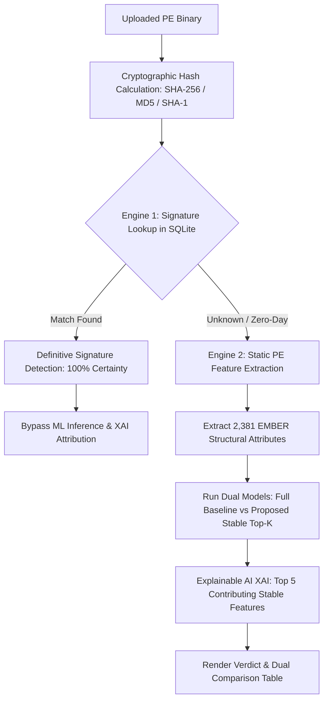

# Hybrid AI Malware Detection & Cross-Dataset Stable PE Feature Selection

An end-to-end Machine Learning and CyberDefense platform designed to counter **temporal distribution shift** in Windows PE malware classification. Combines a **two-stage hybrid detection architecture** (Signature Catalog + Machine Learning) with **Multi-Year Cross-Dataset Feature Stability Selection** and **Explainable AI (XAI)**.

---

## 🔬 Research Overview & Problem Statement

### The Problem: Temporal Concept Drift & Single-Dataset Overfitting
Standard malware detection models trained on a single snapshot of data (e.g. EMBER 2018) rapidly decay when deployed in the wild. They overfit to ephemeral temporal artifacts (such as transient compiler flags, specific packer versions, or short-lived import table configurations) that adversaries discard or modify over time.

### The Solution: Cross-Dataset Consensus Stability
Our methodology evaluates feature importance independently across distinct temporal datasets (**EMBER 2017 v2** and **EMBER 2018**):
1. **Multi-Year Stability Consensus:** Computes mutual information and tree-based Gini importance across both temporal distributions.
2. **Invariant Feature Selection:** Ranks features by their joint rank stability $S(f) = \min(\text{Rank}_{2017}(f), \text{Rank}_{2018}(f))$.
3. **Out-of-Distribution (OOD) Validation:** Evaluated on the independent **BODMAS (2020)** benchmark dataset (57,293 real-world binaries).

---

## 📊 Key Experimental Results (BODMAS 2020 OOD Benchmark)

| Model Configuration | Feature Count ($K$) | Pruning Rate | OOD Accuracy (2020) | ROC-AUC | Inference Latency | False Negatives Recovered |
| :--- | :---: | :---: | :---: | :---: | :---: | :---: |
| **Full Baseline (2018)** | 2,381 | 0.0% | 83.48% | 0.9251 | 7.42 ms | Baseline |
| **Single-Dataset Top-100 (Naive)** | 100 | 95.8% | 68.01% | 0.8403 | 1.86 ms | - |
| **Proposed Stable Top-100 (Optimal)** | **100** | **95.8%** | **71.09% (+3.08%)** | **0.8797** | **1.90 ms (74% Speedup)** | **+295 Threats Recovered** |
| **Proposed Stable Top-200** | **200** | **91.6%** | **77.54%** | **0.9203** | **2.80 ms (62% Speedup)** | **Parity with Full Baseline** |

> **Key Finding:** By eliminating 95.8% of noisy/ephemeral dimensions and retaining only cross-dataset stable features, the model achieves a **74% inference speedup** while recovering **+295 malicious binaries** that naive single-year feature selection missed.

---

## 🛡️ Hybrid Two-Stage Detection Architecture



### 1. Stage 1: Signature Verification (Fast Path)
* Queries a local SQLite catalog populated with MalwareBazaar signatures (WannaCry, RedLineStealer, AgentTesla, Emotet, EICAR).
* Matches on SHA-256 digests or standard byte signatures.
* Immediately returns **100% certainty** and **bypasses ML inference** to avoid false negatives on known threats.

### 2. Stage 2: Machine Learning & Explainable AI (Zero-Day Path)
* For unknown binaries, parses PE structure via the static EMBER extractor (headers, sections, import address table, entropy, byte distributions) without code execution.
* Evaluates both **Full Baseline (2,381 features)** and **Proposed Stable (Top-$K$)** models in parallel.
* Generates a **Dual-Model Head-to-Head Comparison Table** contrasting verdict, confidence, latency, and speedup.
* Provides **Top 5 Contributing Stable Features** with local attribution scores ($|x_i \cdot w_i|$) and plain-English cybersecurity context (e.g., COFF timestomping evasion, section entropy packing).

---

## 📁 Repository Structure

```
├── AI Maleware Detection/            # Complete Web Application
│   ├── app.py                         # Flask application & dual routing engine
│   ├── ai/
│   │   └── ai_scan.py                 # Dual-model evaluation & XAI attribution
│   ├── models/
│   │   ├── rf_full_2381.joblib        # Full baseline model (2,381 features)
│   │   ├── rf_stable_k20.joblib       # Top-20 stable model
│   │   ├── rf_stable_k50.joblib       # Top-50 stable model
│   │   ├── rf_stable_k100.joblib      # Top-100 optimal stable model
│   │   ├── rf_stable_k200.joblib      # Top-200 stable model
│   │   └── selected_indices.json      # Stable feature index mappings
│   ├── signatures/
│   │   ├── signature_scan.py          # SQLite & byte signature scanner
│   │   ├── create_db.py               # Database initialization
│   │   └── download_hashes.py         # MalwareBazaar sync utility
│   ├── database/
│   │   └── signatures.db              # SQLite signature catalog & scan logs
│   ├── utils/
│   │   ├── ember_features.py          # Static PE feature extractor
│   │   ├── hash_utils.py              # Cryptographic hash generator
│   │   └── feature_names.py           # 2,381 human-readable PE feature mapping
│   ├── templates/                     # Cyberpunk dark-glass UI
│   │   ├── index.html                 # Upload page with Top-K selector pills
│   │   ├── result.html                # Verdict, dual comparison & XAI cards
│   │   └── history.html               # Scan audit log & history management
│   ├── static/
│   │   └── style.css                  # Custom cyber aesthetic styling
│   └── requirements.txt               # Application dependencies
├── demo_research_contribution.py      # Standalone research benchmark script
├── run_experiments.py                 # Cross-dataset stability experiment pipeline
├── vectorize_ember.py                 # EMBER raw feature vectorization
├── ember_features.py                  # Core PE feature extraction utility
├── feature_names.py                   # Canonical EMBER feature taxonomy
└── .gitignore                         # Excludes 20GB raw dataset binaries
```

---

## 🚀 Getting Started

### Prerequisites
* Python 3.9+
* Recommended: Virtual environment (`venv`)

### Installation

1. **Clone the repository:**
   ```bash
   git clone https://github.com/<your-username>/<your-repo-name>.git
   cd <your-repo-name>
   ```

2. **Install dependencies:**
   ```bash
   pip install -r "AI Maleware Detection/requirements.txt"
   ```

3. **Run the Web Application:**
   ```bash
   cd "AI Maleware Detection"
   python app.py
   ```
   Open your browser and navigate to `http://127.0.0.1:5000`.

4. **Run Research Benchmarks:**
   ```bash
   python demo_research_contribution.py
   ```

---

## 📈 Explainable AI (XAI) Attribution Example

When an unknown binary is scanned, the system isolates the structural PE anomalies driving the decision:

| Rank | Category | Feature Name | Global Index | Impact Score | Security Interpretation |
| :---: | :--- | :--- | :---: | :---: | :--- |
| **#1** | `[PE Header]` | COFF Timestamp | 144 | High | Compilation timestamp anomaly; detects anti-forensic timestomping evasion. |
| **#2** | `[Data Directories]` | Import Table Size | 622 | High | Captures linked API dependencies; empty/truncated tables indicate packed shellcode. |
| **#3** | `[General PE]` | File Size | 617 | Medium | Disproportionate code-to-file size ratio highlights embedded carrier payloads. |
| **#4** | `[Data Directories]` | Debug Directory Size | 628 | Medium | Stripped or scrubbed debug directory metadata indicates evasion behavior. |
| **#5** | `[Byte Entropy]` | Byte Entropy Histogram | 321 | Medium | Elevated section entropy signifies compressed or encrypted payloads. |

---

## 📜 License
This project is open-source under the MIT License.
