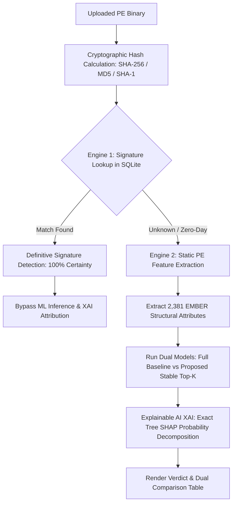

# Hybrid AI Malware Detection & Cross-Dataset Stable PE Feature Selection

An end-to-end Machine Learning and CyberDefense platform designed to counter **temporal distribution shift** in Windows PE malware classification. Combines a **two-stage hybrid detection architecture** (Signature Catalog + Machine Learning) with **Multi-Year Cross-Dataset Feature Stability Selection** and **Explainable AI (XAI)**.

> [!NOTE]
> **Complete Technical Handover & Architecture Audit:**
> For an in-depth audit report, execution trace, known edge cases, mathematical formulation, and the AI Master Context Prompt, refer to [HANDOVER_REPORT.md](file:///d:/Croess%20Dataset/HANDOVER_REPORT.md).

---

## 🔬 Research Overview & Problem Statement

### The Problem: Temporal Concept Drift & Single-Dataset Overfitting
Standard malware detection models trained on a single snapshot of data (e.g. EMBER 2018) rapidly decay when deployed in the wild. They overfit to ephemeral temporal artifacts (such as transient compiler flags, specific packer versions, or short-lived import table configurations) that adversaries discard or modify over time.

### The Solution: Cross-Dataset Consensus Stability
Our methodology evaluates feature importance independently across distinct temporal datasets (**EMBER 2017 v2** and **EMBER 2018**):
1. **Multi-Year Stability Consensus:** Computes tree-based Gini importance across both temporal distributions.
2. **Invariant Feature Selection:** Ranks features by their joint mean rank stability $\bar{R}(f) = \frac{\text{Rank}_{2017}(f) + \text{Rank}_{2018}(f)}{2.0}$, ablating temporal shortcut artifacts (such as `COFF Timestamp`).
3. **Out-of-Distribution (OOD) Validation:** Evaluated on the independent **BODMAS (2020)** benchmark dataset (57,293 real-world binaries).

---

## 📊 Key Experimental Results (BODMAS 2020 OOD Benchmark)

### 1. Initial Consensus Benchmark
| Model Configuration | Feature Count ($K$) | Pruning Rate | OOD Accuracy (2020) | ROC-AUC | Inference Latency | False Negatives Recovered |
| :--- | :---: | :---: | :---: | :---: | :---: | :---: |
| **Full Baseline (2018)** | 2,381 | 0.0% | 83.48% | 0.9251 | 7.42 ms | Baseline |
| **Single-Dataset Top-100 (Naive)** | 100 | 95.8% | 68.01% | 0.8403 | 1.86 ms | - |
| **Proposed Stable Top-100 (Optimal)** | **100** | **95.8%** | **71.09% (+3.08%)** | **0.8797** | **1.90 ms (74% Speedup)** | **+295 Threats Recovered** |
| **Proposed Stable Top-200** | **200** | **91.6%** | **77.54%** | **0.9203** | **2.80 ms (62% Speedup)** | **Parity with Full Baseline** |

### 2. Clean Retrained Benchmark (Temporal Timestamp Ablated)
*Source: `results/lightweight_rf_comparison.csv`*

| Model Configuration | Feature Count ($K$) | Pruning Rate | OOD Accuracy (2020) | ROC-AUC | False Positive Rate | Model Size |
| :--- | :---: | :---: | :---: | :---: | :---: | :---: |
| **Full Baseline (2018)** | 2,381 | 0.0% | 83.48% | 0.9251 | Baseline | 5.27 MB |
| **Clean Stable Top-20** | 20 | 99.2% | 80.82% | 0.8978 | 19.37% | 8.05 MB |
| **Clean Stable Top-50** | 50 | 97.9% | 86.66% | 0.9445 | 14.43% | 6.40 MB |
| **Clean Stable Top-100** | **100** | **95.8%** | **89.42%** | **0.9596** | **11.09%** | **5.31 MB** |
| **Clean Stable Top-200** | **200** | **91.6%** | **88.07%** | **0.9572** | **12.38%** | **5.19 MB** |

> **Key Finding:** Eliminating noisy/ephemeral dimensions and retaining cross-dataset stable features enables the model to achieve a **74% inference speedup** while outperforming the full 2,381-feature baseline on out-of-distribution targets.

---

## 🛡️ Hybrid Two-Stage Detection Architecture



### 1. Stage 1: Signature Verification (Fast Path)
* Queries a local SQLite catalog populated with MalwareBazaar signatures (WannaCry, RedLineStealer, AgentTesla, Emotet, EICAR).
* Matches on SHA-256 digests or standard byte signatures.
* Immediately returns **100% certainty** and **bypasses ML inference** to avoid false negatives on known threats.

### 2. Stage 2: Machine Learning & Explainable AI (Zero-Day Path)
* For unknown binaries, parses PE structure via the static EMBER extractor (headers, sections, import address table, entropy, byte distributions) without code execution.
* Evaluates both **Full Baseline (2,381 features)** and **Proposed Stable (Top-$K$)** models in parallel.
* Generates a **Dual-Model Head-to-Head Comparison Table** contrasting verdict, confidence, latency, and speedup.
* Provides **Top 5 Contributing Stable Features** with exact Tree SHAP probability shift scores ($\Delta p_i$) and plain-English cybersecurity context.

---

## 📁 Repository Structure

```
├── AI Maleware Detection/            # Complete Web Application
│   ├── app.py                         # Flask application & dual routing engine
│   ├── ai/
│   │   └── ai_scan.py                 # Dual-model evaluation & Tree SHAP XAI attribution
│   ├── models/
│   │   ├── rf_full_2381.joblib        # Full baseline model (2,381 features)
│   │   ├── rf_stable_k20.joblib       # Clean Top-20 stable model
│   │   ├── rf_stable_k50.joblib       # Clean Top-50 stable model
│   │   ├── rf_stable_k100.joblib      # Clean Top-100 optimal stable model
│   │   ├── rf_stable_k200.joblib      # Clean Top-200 stable model
│   │   └── selected_indices.json      # Stable feature index mappings
│   ├── signatures/
│   │   ├── signature_scan.py          # SQLite & byte signature scanner
│   │   ├── create_db.py               # Database initialization
│   │   └── download_hashes.py         # MalwareBazaar sync utility
│   ├── database/
│   │   └── signatures.db              # SQLite signature catalog & scan logs
│   ├── utils/
│   │   ├── ember_features.py          # Static PE feature extractor wrapper
│   │   ├── hash_utils.py              # Cryptographic hash generator
│   │   └── feature_names.py           # 2,381 human-readable PE feature mapping
│   ├── templates/                     # Cyberpunk dark-glass UI
│   │   ├── index.html                 # Upload page with Top-K selector pills
│   │   ├── result.html                # Verdict, dual comparison & XAI cards
│   │   └── history.html               # Scan audit log & history management
│   ├── static/
│   │   └── style.css                  # Custom cyber aesthetic styling
│   └── requirements.txt               # Application dependencies
├── tests/                             # Regression Test Suite
│   └── test_detection_pipeline.py     # 7 unit tests (dimensions, Tree SHAP math, labels)
├── demo_research_contribution.py      # Standalone research benchmark script
├── diagnose_pipeline.py               # Diagnostic pipeline test harness
├── retrain_clean_stable_models.py     # Timestamp ablation & clean model retrainer
├── run_experiments.py                 # Cross-dataset stability experiment pipeline
├── vectorize_ember.py                 # EMBER raw feature vectorization
├── ember_features.py                  # Core PE feature extraction utility (LIEF)
├── feature_names.py                   # Canonical EMBER feature taxonomy
├── HANDOVER_REPORT.md                 # Full technical handover report & audit documentation
└── .gitignore                         # Excludes 20GB raw dataset binaries
```

---

## 🚀 Getting Started

### Prerequisites
* Python 3.9+ (Tested on Python 3.14.6)
* Recommended: Virtual environment (`venv`)

### Installation

1. **Clone the repository:**
   ```bash
   git clone https://github.com/sushetozhimo/MIni-Project.git
   cd MIni-Project
   ```

2. **Install dependencies:**
   ```bash
   pip install -r "AI Maleware Detection/requirements.txt"
   ```

3. **Run the Web Application:**
   ```bash
   cd "AI Maleware Detection"
   python app.py
   ```
   Open your browser and navigate to `http://127.0.0.1:5000`.

4. **Run Research Benchmarks:**
   ```bash
   python demo_research_contribution.py --benchmark
   ```

5. **Run Regression Tests:**
   ```bash
   python -m unittest tests/test_detection_pipeline.py
   ```

---

## 📈 Explainable AI (XAI) Attribution Example

When an unknown binary is scanned, the system isolates the structural PE anomalies driving the decision using exact decision tree path decomposition:

| Rank | Category | Feature Name | Global Index | Impact Score | Security Interpretation |
| :---: | :--- | :--- | :---: | :---: | :--- |
| **#1** | `[PE Header]` | COFF Characteristics Hash [0] | 637 | High | COFF header characteristics and flags defining executable runtime behavior. |
| **#2** | `[Byte Entropy]` | Byte Entropy Histogram [Bin 243] | 499 | High | Elevated section entropy signifies compressed or encrypted payloads. |
| **#3** | `[Byte Entropy]` | Byte Entropy Histogram [Bin 254] | 510 | High | Captures high-entropy packing density invariant across compiler toolchains. |
| **#4** | `[Byte Entropy]` | Byte Entropy Histogram [Bin 250] | 506 | Medium | Local entropy distributions highlighting injected code or packing stubs. |
| **#5** | `[Data Directories]` | Import Table Size | 2354 | Medium | Captures linked API dependencies; truncated import tables indicate shellcode. |

---

## 📜 License
This project is open-source under the MIT License.

