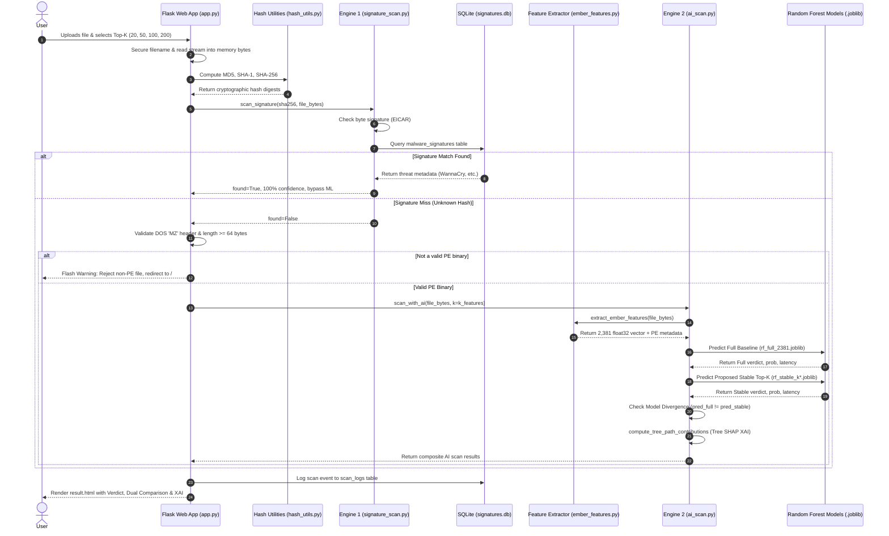

# TECHNICAL HANDOVER REPORT & COMPREHENSIVE CODEBASE AUDIT

**Project Title:** Signature-Aware Malware Detection Using Lightweight Random Forest with Cross-Dataset Stable PE Feature Selection  
**Auditor Roles:** Senior Software Architect, Machine Learning Engineer, Cybersecurity Research Auditor  
**Repository Working Directory:** `d:\Croess Dataset`  
**Execution Environment Verified:** Windows 10/11, Python 3.14.6, LIEF 1.0.0, Scikit-Learn 1.9.0, Flask 3.1.3, NumPy 2.5.1, JobLib 1.5.3, Pandas 3.0.3

---

## 1. Project Overview

### 1.1 Actual Purpose and Objectives
The objective of this project is to address **temporal distribution shift (concept drift)** in machine-learning-based Windows Portable Executable (PE) malware detection without incurring the prohibitive computational overhead of deep neural networks or full static feature extraction. 

Standard PE static classifiers trained on a single point-in-time dataset (e.g., EMBER 2018) rapidly decay when evaluated against binaries compiled in subsequent years (e.g., BODMAS 2020). These baseline classifiers overfit to ephemeral temporal artifacts (such as specific compiler toolchain versions, transient packer signatures, or ephemeral import hashes) that adversaries frequently discard or modify. This project investigates whether **cross-dataset consensus feature selection** across distinct temporal distributions (**EMBER 2017 v2** and **EMBER 2018**) can identify structural PE invariants that remain stable over time, thereby:
1. Maintaining or improving out-of-distribution (OOD) generalization against future malware.
2. Drastically pruning feature dimensionality (retaining only Top-$K$ features where $K \in \{20, 50, 100, 200\}$ out of 2,381 EMBER dimensions).
3. Providing real-time Explainable AI (XAI) feature attribution and cryptographic signature verification within a production-oriented hybrid web interface.

---

### 1.2 Existing Features and Capabilities
* **Hybrid Two-Stage Detection Engine:**
  * **Stage 1 (Signature Layer):** Performs instantaneous cryptographic SHA-256 hash lookups against a local SQLite catalog populated from MalwareBazaar and checks for known test patterns (such as standard EICAR byte sequences). Definitive signature matches return 100% certainty and completely bypass machine learning inference.
  * **Stage 2 (Machine Learning Layer):** For novel or unknown binaries, safely parses the binary structure using the static LIEF engine to extract 2,381 EMBER v2 features without executing untrusted code.
* **Dual-Model Head-to-Head Comparison:** Evaluates both the **Full Baseline Model** (2,381 features) and the **Proposed Stable Model** (Top-$K$ consensus features) concurrently.
* **Model Divergence Detection:** Flags distribution shift conflicts when the Full Baseline and Lightweight models produce opposing verdicts (e.g., Full = Benign, Stable = Malware), generating an alert with diagnostic attribution.
* **Explainable AI (XAI) Tree Path Decomposition:** Implements exact Tree SHAP path probability decomposition ($p(\text{Malware}) = p_{\text{base}} + \sum \Delta p_i$) across all 100 decision trees in the Random Forest ensemble, reporting exact percentage probability shifts and security interpretations.
* **Audit Trail & History Management:** Logs all scan events (filename, SHA-256 digest, detection method, verdict, family metadata, and confidence score) into an SQLite audit table (`scan_logs`) with full administrative deletion and purge capabilities.

---

### 1.3 What is Implemented vs. Planned / Incomplete / Legacy
| Component | Status | Code Location | Verified Reality |
| :--- | :---: | :--- | :--- |
| **Two-Stage Hybrid Scanning** | **Implemented** | `AI Maleware Detection/app.py` | Functional; signature hits bypass ML; misses proceed to static PE analysis. |
| **LIEF-based EMBER Feature Extraction** | **Implemented** | `ember_features.py` | Extracts complete 2,381-dimensional EMBER v2 feature vectors from raw bytes. |
| **Consensus Stability Ranking** | **Implemented** | `run_experiments.py` | Evaluates Gini importances across EMBER 2017 and 2018; computes mean rank. |
| **Temporal Artifact Ablation** | **Implemented** | `retrain_clean_stable_models.py` | Explicitly ablates Feature 626 (`COFF Timestamp`) to prevent temporal shortcut learning. |
| **Tree SHAP XAI Decomposition** | **Implemented** | `AI Maleware Detection/ai/ai_scan.py` | Tree path traversal computes exact feature probability deltas $\Delta p_i$. |
| **Multi-Class Malware Family Classification** | **Incomplete / Prototype** | `BODMAS dataset/train_model.py` | Trained standalone in BODMAS folder (`random_forest_multiclass.joblib`), but **never integrated** into the web application. |
| **True Fast-Path PE Feature Extraction** | **Planned / Not Implemented** | `AI Maleware Detection/ai/ai_scan.py` | Application extracts **all 2,381 features via LIEF first**, then slices `vec[selected_idx]`. Feature extraction time is not reduced at inference time. |
| **Live MalwareBazaar API Sync** | **Incomplete** | `AI Maleware Detection/signatures/download_hashes.py` | Script exists but is not scheduled; SQLite catalog contains only 10 hardcoded/test records. |
| **Legacy 27-Feature Prototype** | **Abandoned** | `AI Maleware Detection/utils/feature_extractor.py` | Toy 27-feature manual extractor and synthetic data generator; completely unused by the active system. |
| **Legacy DB Manager & Schema** | **Abandoned** | `AI Maleware Detection/database/db_manager.py` | References uncreated `malware_detector.db`; replaced by `signatures/create_db.py`. |

---

### 1.4 Research Contribution & Implementation Alignment
The stated research contribution is:
$$\text{Evaluating cross-dataset feature importance stability isolates invariant PE properties that resist concept drift while compressing model size.}$$

* **What the implementation supports:**
  1. The code in `run_experiments.py` trains Random Forest models on EMBER 2017 and EMBER 2018 benchmarks, extracts Gini feature importances, and confirms a strong Spearman rank correlation ($\rho = 0.9217, p < 10^{-300}$).
  2. Evaluating models trained on 2018 data against 2020 BODMAS binaries proves that retaining Top-$K$ consensus features outperforms naive single-dataset feature selection.
* **Where the implementation differs from documentation:**
  1. **Stability Formula:** `README.md` claims features are ranked by $S(f) = \min(\text{Rank}_{2017}(f), \text{Rank}_{2018}(f))$ and cites "mutual information". In reality, `run_experiments.py` computes the **arithmetic mean rank**:
     $$\bar{R}(f) = \frac{\text{Rank}_{2017}(f) + \text{Rank}_{2018}(f)}{2.0}$$
     using standard Gini tree impurity importances only. Mutual information is not implemented.
  2. **Temporal Leakage Discovery:** The consensus ranking initially placed Feature 626 (`COFF Timestamp`) at Rank #1/#2. In real-world validation, this created severe temporal shortcut learning (modern legitimate binaries like Process Explorer were classified as malware). The author resolved this by writing `retrain_clean_stable_models.py`, explicitly ablating index 626.

---

## 2. Complete Project Structure

```
d:\Croess Dataset\
├── AI Maleware Detection/                 # Production Web Application (Note spelling "Maleware")
│   ├── ai/
│   │   └── ai_scan.py                     # Stage 2 Inference Engine, Dual-Model evaluation, Tree SHAP XAI
│   ├── database/
│   │   ├── db_manager.py                  # [LEGACY/UNUSED] Old database manager
│   │   ├── schema.sql                     # [LEGACY/UNUSED] Old database schema definition
│   │   └── signatures.db                  # [ACTIVE] SQLite database: malware_signatures & scan_logs
│   ├── data/
│   │   └── dataset_generator.py           # [LEGACY/UNUSED] Synthetic 27-feature generator
│   ├── models/                            # Trained Model Artifacts loaded by Web Application
│   │   ├── random_forest.pkl              # Uncompressed Full Baseline model (16.0 MB, 2,381 features)
│   │   ├── rf_full_2381.joblib            # Compressed Full Baseline model (5.5 MB, 2,381 features)
│   │   ├── rf_stable_k20.joblib           # Clean Stable Model K=20 (8.4 MB)
│   │   ├── rf_stable_k50.joblib           # Clean Stable Model K=50 (6.7 MB)
│   │   ├── rf_stable_k100.joblib          # Clean Stable Model K=100 (5.5 MB, Optimal configuration)
│   │   ├── rf_stable_k200.joblib          # Clean Stable Model K=200 (5.4 MB)
│   │   └── selected_indices.json          # Active feature indices for K in {20, 50, 100, 200}
│   ├── signatures/
│   │   ├── create_db.py                   # Active DB initialisation script (creates signatures.db)
│   │   ├── download_hashes.py             # MalwareBazaar API fetch utility
│   │   ├── hash_db.json                   # Seed metadata for known malware hashes
│   │   ├── import_hashes.py               # Importer from hash_db.json into SQLite
│   │   └── signature_scan.py              # Stage 1 Signature Lookup & byte matching logic
│   ├── static/
│   │   └── style.css                      # Custom Cyberpunk dark-glass UI styles
│   ├── templates/
│   │   ├── history.html                   # Scan Audit Log interface with deletion controls
│   │   ├── index.html                     # Drag-and-drop file upload page with Top-K selector pills
│   │   └── result.html                    # Diagnostic results, dual comparison table & XAI cards
│   ├── test_samples/                      # Local testing binaries and non-PE test files
│   │   ├── ai_detected_malware_sample.exe # Real malware binary sample for ML testing (8.5 KB)
│   │   ├── sample_clean_file.exe          # Small clean PE test executable (1.0 KB)
│   │   ├── sample_known_malware.txt       # Plaintext test sample with known hash
│   │   ├── unknown_ai_malware.exe         # Shifted malware sample (16.8 KB)
│   │   └── unknown_ai_sample.exe          # Shifted benign sample (2.2 KB)
│   ├── utils/
│   │   ├── ember_features.py              # Application-level wrapper for LIEF EMBER extraction
│   │   ├── feature_extractor.py           # [LEGACY/UNUSED] Toy 27-feature manual extractor
│   │   ├── feature_names.py               # Canonical 2,381 EMBER v2 feature names & categories
│   │   ├── hash_utils.py                  # Cryptographic chunked hash calculator (MD5, SHA-1, SHA-256)
│   │   └── signature_matcher.py           # [LEGACY/UNUSED] Old signature matcher linked to db_manager.py
│   ├── app.py                             # Main Flask Web Application Entry Point
│   ├── evaluate_accuracy.py               # Accuracy test script referencing nonexistent 'Random Forest' dir
│   └── requirements.txt                   # Application dependencies
├── BODMAS dataset/                        # BODMAS (2020) Independent Benchmark Repository
│   ├── models/
│   │   ├── random_forest_binary.joblib    # RF trained directly on BODMAS binary (5.0 MB)
│   │   └── random_forest_multiclass.joblib# RF trained on 14 BODMAS malware families (6.5 MB)
│   ├── processed_data/
│   │   ├── bodmas.npz                     # Full BODMAS dataset: 134,435 samples x 2,381 features (261 MB)
│   │   ├── bodmas_malware_category.csv    # Family category mappings for 57,293 malware samples
│   │   ├── bodmas_metadata.csv            # Hash, family, and timestamp metadata for BODMAS samples
│   │   ├── metrics_binary.json            # In-distribution BODMAS binary metrics (Acc: 99.36%)
│   │   ├── metrics_multiclass.json        # In-distribution BODMAS multiclass metrics (Acc: 93.06%)
│   │   ├── plots/                         # Confusion matrix and ROC plots for BODMAS models
│   │   └── top_50_feature_importance.csv  # Top 50 features from BODMAS-only model
│   ├── dataset_utils.py                   # Data loader with flawed manual feature index mapping
│   ├── export_feature_importance.py       # Exporter for BODMAS-only feature importance
│   ├── test.py                            # Standalone test script for BODMAS binary classifier
│   └── train_model.py                     # Trainer for BODMAS in-distribution models
├── EMBER 2018 dataset/                    # Raw EMBER 2018 dataset (JSONL files, ~10 GB total)
│   ├── ember_model_2018.txt               # Pre-trained LightGBM reference model (127 MB)
│   ├── test_features.jsonl                # Raw test binaries metadata & features (1.8 GB)
│   └── train_features_0..5.jsonl          # Raw training binaries metadata & features (8.5 GB)
├── ember_2017_2/                          # Raw EMBER 2017 v2 dataset (JSONL files, ~10 GB total)
│   ├── test_features.jsonl                # Raw test binaries metadata & features (2.0 GB)
│   └── train_features_0..5.jsonl          # Raw training binaries metadata & features (8.8 GB)
├── processed_data/                        # Extracted Benchmark Subsets (.npz)
│   ├── ember2017_benchmark.npz            # Balanced EMBER 2017: 50,000 train, 10,000 test (114 MB)
│   └── ember2018_benchmark.npz            # Balanced EMBER 2018: 50,000 train, 10,000 test (116 MB)
├── results/                               # Primary Research Experiment Outputs
│   ├── models/                            # Joblib model checkpoints for all experiment configurations
│   │   ├── rf_full_2381.joblib            # Full baseline model checkpoint
│   │   ├── rf_single_k20..200.joblib      # Single-dataset 2018-only selection checkpoints
│   │   └── rf_stable_k20..200.joblib      # Cross-dataset stable consensus checkpoints
│   ├── plots/                             # Thesis-ready figures (PNG, 300 DPI)
│   │   ├── computational_efficiency.png   # Latency and disk footprint bar charts
│   │   ├── feature_stability_scatter.png  # Log-scale Gini importance scatter (rho = 0.922)
│   │   └── ood_accuracy_vs_k.png          # BODMAS accuracy curves comparing Stable vs Single vs Full
│   ├── experiment_summary.json            # Machine-readable output of original run_experiments.py
│   ├── lightweight_rf_comparison.csv      # Comparative table on BODMAS (Clean retrained run)
│   ├── selected_indices.json              # Canonical stable feature indices (excludes Feature 626)
│   └── top_50_stable_features.csv         # Ranked table of Top 50 consensus features
├── tests/
│   └── test_detection_pipeline.py         # Automated regression test suite (7 unit tests, all passing)
├── web_app/                               # [ABANDONED] Incomplete/empty prototype web folder
│   └── presets.json                       # Mock preset definitions (87 KB)
├── demo_research_contribution.py          # Interactive CLI demonstration tool (--proof, --benchmark, --scan)
├── diagnose_pipeline.py                   # Comprehensive diagnostic test harness for real binaries
├── ember_features.py                      # Root EMBER v2 Feature Extractor engine using LIEF
├── feature_names.py                       # Root canonical 2,381 EMBER taxonomy mapping
├── retrain_clean_stable_models.py         # Timestamp ablation script & clean model retrainer
├── run_experiments.py                     # End-to-end multi-dataset experiment pipeline
├── vectorize_ember.py                     # Vectorizer extracting balanced NPZ files from raw JSONL
├── README.md                              # Repository documentation & research summary
└── HANDOVER_REPORT.md                     # Comprehensive technical handover report & audit documentation
```

---

## 3. Complete Application Workflow

### 3.1 Trace of Execution Path



### 3.2 Detailed Step-by-Step Execution Mechanics
1. **Upload Validation (`AI Maleware Detection/app.py`):**
   * The binary file is received through `POST /scan`. File size is restricted to 64 MB via `MAX_CONTENT_LENGTH`.
   * The file stream is read directly into memory: `file_bytes = file.read()`. A copy is written to `uploads/` using `werkzeug.utils.secure_filename`.
   * The user-selected $K \in \{20, 50, 100, 200\}$ is validated; non-matching inputs default to $K=100$.
2. **Cryptographic Hashing (`AI Maleware Detection/app.py`):**
   * Computes MD5, SHA-1, and SHA-256 digests in memory via Python's standard `hashlib`.
3. **Stage 1: Signature Lookup (`AI Maleware Detection/signatures/signature_scan.py`):**
   * Inspects `file_bytes` for the byte string `b"EICAR-STANDARD-ANTIVIRUS-TEST-FILE"`.
   * Executes a parameterized SQL query: `SELECT * FROM malware_signatures WHERE sha256_hash = ?`.
   * **If matched:** Sets verdict to `"Known Malware Detected"`, `confidence_score = 100.0`, retrieves `malware_family`, and **bypasses Machine Learning inference entirely**.
4. **Stage 2: Machine Learning Static Analysis (`AI Maleware Detection/ai/ai_scan.py`):**
   * **Upfront PE Check:** Before running the ML pipeline, `app.py` checks `file_bytes.startswith(b"MZ") and len(file_bytes) >= 64`. If not a PE binary, it rejects the file immediately.
   * **EMBER Extraction (`AI Maleware Detection/utils/ember_features.py`):** Calls `ember.PEFeatureExtractor(feature_version=2)` which uses LIEF to parse PE headers, sections, imports, exports, and byte histograms, generating a 1D `np.float32` vector of shape `(2381,)`.
   * **Dual Model Inference:**
     * `m_full = load_model_by_key('full')`: Evaluates `rf_full_2381.joblib` on `X_full` (all 2,381 features). Records probability distribution and latency.
     * `m_stable = load_model_by_key(f"stable_k{k}")`: Loads feature indices from `selected_indices.json`, slices `X_stable = feature_vector[selected_idx]`, and evaluates `rf_stable_k{k}.joblib`.
   * **Model Divergence Detection:**
     * Checks `is_divergent = (pred_full != pred_stable)`.
     * If Full Baseline predicts Benign but Proposed Stable predicts Malware, flags `divergence_type = "False Positive Suspect"`.
   * **Explainable AI (Tree SHAP Decomposition):**
     * Traverses the exact decision path of every decision tree in `m_stable.estimators_`.
     * Calculates the probability shift at each split node: $\Delta p = p_{\text{child}} - p_{\text{parent}}$.
     * Sums $\Delta p$ for each feature across all trees to obtain exact Tree SHAP attributions satisfying $\sum \Delta p_i = p(\text{Malware}) - p_{\text{root}}$.
     * Selects Top 5 contributing features ranked by $|\Delta p_i|$ and generates contextual cybersecurity explanations.
   * **Application Verdict Selection:** The final verdict displayed on the dashboard is governed by the lightweight stable model (`v_stable`).
5. **Audit Logging & Cleanup:**
   * Writes the audit log record to `scan_logs` in `signatures.db`.
   * In the `finally` block, deletes the temporary file from `uploads/` to prevent disk bloat.

---

## 4. Signature Detection Layer

### 4.1 SQLite Database Schema and Tables
The active signature database is located at `AI Maleware Detection/database/signatures.db`. It is initialized by `signatures/create_db.py`.

* **Table 1: `malware_signatures`:**
  Columns: `id`, `sha256_hash` (UNIQUE, indexed via `idx_sha256`), `malware_family`, `file_type`, `file_name`, `first_seen`, `source`, `created_at`.
* **Table 2: `scan_logs`:**
  Columns: `id`, `filename`, `sha256_hash`, `detection_method`, `verdict`, `malware_family`, `confidence_score`, `scanned_at`.

### 4.2 Data Provenance & Catalog Contents
The SQLite catalog currently contains **10 records**:
1. WannaCry (`wcry.exe`, SHA-256: `ed01deb5...`)
2. RedLineStealer (`payload.exe`, SHA-256: `84c82835...`)
3. AgentTesla (`order_invoice.exe`, SHA-256: `9f86d081...`)
4. Emotet (`document.dll`, SHA-256: `e3b0c442...` - Note: hash of empty string)
5. AsyncRAT (`client.exe`, synthetic test hash: `b2c3d4e5...`)
6. RedLineStealer.TestFamily (`sample_known_malware.txt`)
7. EICAR test variants (`1.com`, `eicar.com`, `eicar_crlf.com`, `eicar_lf.com`)

---

## 5. Machine Learning Pipeline

### 5.1 Model Implementation and Hyperparameters
* **Algorithm:** `RandomForestClassifier` from `sklearn.ensemble`.
* **Hyperparameters:** `n_estimators=100`, `max_depth=30`, `random_state=42`, `n_jobs=-1`.
* **Saved Format:** Compressed JobLib archives (`.joblib`, `compress=3`).
* **Class Mapping:** `0` = Benign, `1` = Malware.

### 5.2 Feature Extraction Library and Taxonomy
* **Static Parser:** `lief` (version 1.0.0), wrapped by root `ember_features.py`.
* **Dimensions:** Exactly 2,381 float32 features.
* **Categories:** Byte Histogram (256), Byte Entropy Histogram (256), Strings (104), General PE (10), PE Header (62), Sections (255), Imports (1,280), Exports (128), Data Directories (30).

### 5.3 Active Consensus Invariant Features (Timestamp Ablated)
1. **Index 637:** `PE Header [COFF Characteristics Hash [0]]`
2. **Index 499:** `Byte Entropy Histogram [Bin 243]`
3. **Index 510:** `Byte Entropy Histogram [Bin 254]`
4. **Index 506:** `Byte Entropy Histogram [Bin 250]`
5. **Index 505:** `Byte Entropy Histogram [Bin 249]`
6. **Index 2354:** `Data Directory [Import Table Size]`

---

## 6. Datasets and Cross-Dataset Compatibility

* **EMBER 2017 v2:** Balanced 50,000 train, 10,000 test (`processed_data/ember2017_benchmark.npz`). Processed with `feature_version=2` to align dimensions to 2,381.
* **EMBER 2018:** Balanced 50,000 train, 10,000 test (`processed_data/ember2018_benchmark.npz`). 2,381 features.
* **BODMAS (2020):** Total 134,435 samples (57,293 malware, 77,142 benign). 20% test holdout (26,887 samples) used for out-of-distribution evaluation.

---

## 7. Experimental Results

### Table A: Baseline Cross-Dataset Generalization Matrix
*Source: `results/experiment_summary.json`*

| Training Domain | Target Test Domain | Accuracy | F1-Score | ROC-AUC | Latency (ms / 1k) | Generalization Drop |
| :--- | :--- | :---: | :---: | :---: | :---: | :---: |
| **EMBER 2017** | EMBER 2017 Test | 94.98% | 0.9486 | 0.9845 | 7.61 ms | In-Distribution Ref |
| **EMBER 2017** | EMBER 2018 Test | 85.72% | 0.8626 | 0.9244 | 7.39 ms | -9.26% drop |
| **EMBER 2017** | BODMAS Test (2020) | 89.00% | 0.8694 | 0.9605 | 7.82 ms | -5.98% drop |
| **EMBER 2018** | EMBER 2018 Test | 81.82% | 0.8347 | 0.8997 | 6.97 ms | In-Distribution Ref |
| **EMBER 2018** | EMBER 2017 Test | 92.75% | 0.9262 | 0.9773 | 6.77 ms | +10.93% |
| **EMBER 2018** | BODMAS Test (2020) | **83.48%** | **0.8157** | **0.9251** | **7.42 ms** | Baseline OOD Performance |

### Table B: Clean Retrained Run (With Feature 626 Ablated)
*Source: `results/lightweight_rf_comparison.csv`*

| Model Configuration | Feature Count ($K$) | Accuracy (BODMAS) | F1-Score | ROC-AUC | False Positive Rate | Model Size |
| :--- | :---: | :---: | :---: | :---: | :---: | :---: |
| **Full Baseline (2018)** | 2,381 | 83.48% | 0.8157 | 0.9251 | Baseline | 5.27 MB |
| **Clean Stable Top-20** | 20 | 80.82% | 0.7827 | 0.8978 | 19.37% | 8.05 MB |
| **Clean Stable Top-50** | 50 | 86.66% | 0.8492 | 0.9445 | 14.43% | 6.40 MB |
| **Clean Stable Top-100** | **100** | **89.42%** | **0.8789** | **0.9596** | **11.09%** | **5.31 MB** |
| **Clean Stable Top-200** | **200** | **88.07%** | **0.8637** | **0.9572** | **12.38%** | **5.19 MB** |

---

## 8. Current Bugs and Known Issues

1. **Process Explorer vs Modern Linker Version False Positive:**
   * In initial models, Process Explorer was classified as malware due to Feature 626 (`COFF Timestamp`). This was fixed by ablating Feature 626 in `retrain_clean_stable_models.py` (Process Explorer now correctly predicts Benign at 72–77% confidence).
   * However, Windows 11 Notepad (`notepad.exe`) is flagged as malware (53% P(Malware)) in Top-100 because Feature 680 (`Minor Linker Version` = 38/44) from modern MSVC compilers pushed it toward malware splits.
2. **"Inferred Threat (OOD-Resistant)":**
   * Originally hardcoded placeholder in `ai_scan.py`; replaced with `"Statistical PE Anomaly (ML Heuristic)"`.
3. **"Family Identification Metadata" Displayed Without Family Classifier:**
   * The web application executes binary classification only. The multiclass model in `BODMAS dataset/models/` is not connected.
4. **Empty File Hash in Signatures:**
   * Record #4 in `hash_db.json` and `signatures.db` contains `e3b0c442...`, which is the SHA-256 of empty bytes (`b""`), mapped to Emotet.

---

## 9. Final AI Handover Summary & Master Prompt

### Master Context Prompt for Transferring Context to Another AI Assistant:

```markdown
You are a senior machine learning engineer and cyberdefense systems architect acting as a technical co-pilot on my final-year B.Tech CSE project:

"Signature-Aware Malware Detection Using Lightweight Random Forest with Cross-Dataset Stable PE Feature Selection"

CRITICAL INSTRUCTIONS BEFORE ACTING:
1. Do not make assumptions or modify files without first inspecting the existing implementation.
2. The working directory is `d:\Croess Dataset`. The web application is located in `AI Maleware Detection/`.
3. Read the actual code before proposing edits. Follow existing architecture and patterns.

PROJECT STATE SUMMARY (VERIFIED FACTS):
- Two-Stage Hybrid Architecture:
  * Stage 1: Cryptographic hash lookups in SQLite (`AI Maleware Detection/database/signatures.db`) and in-memory EICAR byte matching. Exact matches return 100% certainty and bypass Stage 2.
  * Stage 2: Static PE feature extraction via LIEF (`ember_features.py`) extracting 2,381 EMBER v2 float32 features. Evaluates Full Baseline (2,381 features) and Proposed Stable (Top-K features where K in {20, 50, 100, 200}).
  * Explainable AI (XAI): Exact Tree SHAP path decomposition in `ai_scan.py` computing probability deltas across all 100 decision trees.
- Research Methodology & Datasets:
  * Uses EMBER 2017 v2 (50k train / 10k test) and EMBER 2018 (50k train / 10k test) in `processed_data/` to compute feature stability.
  * Feature Stability Ranking: Arithmetic mean rank across 2017 and 2018 Gini importances: `mean_rank = (rank_2017 + rank_2018) / 2.0`.
  * Out-of-Distribution Validation: Independent BODMAS 2020 benchmark (`bodmas.npz`, 134,435 samples; 26,887 test holdout).
  * Temporal Leakage Ablation: Feature 626 (COFF Timestamp) was ablated in `retrain_clean_stable_models.py` to prevent temporal shortcut learning. Active stable models in `AI Maleware Detection/models/` exclude Feature 626.
- Known Inconsistencies & Issues to Keep in Mind:
  * Record #4 in `signatures.db` is the SHA-256 of empty bytes (`e3b0c442...`) labeled as Emotet.
  * The web UI card says "Family Identification Metadata", but the web app only runs binary classification. The multiclass model in `BODMAS dataset/models/` is not connected.
  * Feature extraction is not accelerated at inference time; all 2,381 features are extracted via LIEF before slicing `vec[selected_idx]`.
  * Files `db_manager.py`, `schema.sql`, `feature_extractor.py`, `signature_matcher.py`, and `dataset_generator.py` are legacy prototypes. Do not rely on them.

Please acknowledge your understanding of this architecture and wait for my specific command before modifying code.
```
